# Animations

Choose a companion in **Settings → Animated graphic**. The choices appear in the order below, and each preview cycles through the same seven states.

These stills use the packaged notification assets. Countdown rows read left to right at **25%, 50%, and 75% of the predicted interval elapsed**. Other rows show one representative frame; the descriptions explain motion that a still cannot show. The live graphic uses your theme color and is dimmed during off-time.

“Learning” means there is no prediction yet. Passing an expected end or start keeps the current phase until you end or start the epoch yourself.

- [Sun and moon](#sun-and-moon)
- [Coffee cup](#coffee-cup)
- [Starship](#starship)

## Sun and moon

The sun represents an active epoch; the crescent moon represents off-time. Each descends toward the horizon as its predicted interval runs out. This follows your epochs, independently of actual daylight.

| State | Stills | Behavior |
| --- | --- | --- |
| Ready to start |  | Sun peeking above the horizon, stationary. |
| Epoch · learning | 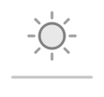 | Sun at a fixed height with rotating rays; no predicted progress yet. |
| Epoch · countdown |    | Sun descends toward the horizon, with rotating rays. |
| Epoch · past expected end |  | Sun remains partly below the horizon; its rays gently pulse. |
| Off-time · learning | 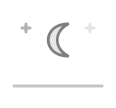 | Moon at a fixed height with twinkling stars; no predicted progress yet. |
| Off-time · countdown | 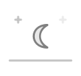 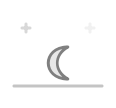 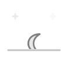 | Moon descends toward the horizon as the stars fade. |
| Off-time · past expected start | 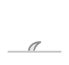 | Moon remains at the horizon with a gentle pulse. |

## Coffee cup

The liquid level represents the remaining epoch or the progress of off-time. The cup empties during an epoch and refills during off-time.

| State | Stills | Behavior |
| --- | --- | --- |
| Ready to start |  | Empty cup. |
| Epoch · learning |  | Empty cup with drifting steam; no predicted fill level yet. |
| Epoch · countdown | 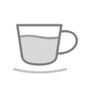   | Liquid level falls toward empty. |
| Epoch · past expected end |  | Cup stays empty. |
| Off-time · learning | 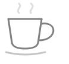 | Empty cup with drifting steam; no predicted fill level yet. |
| Off-time · countdown |  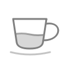  | Liquid level rises toward full. |
| Off-time · past expected start |  | Cup stays full. |

## Starship

The fuel tank drains during an active epoch and refills on the launch pad during off-time.

| State | Stills | Behavior |
| --- | --- | --- |
| Ready to start |  | Empty tank on the launch pad. |
| Epoch · learning |  | Flickering nozzle flame, without a predicted fuel level. |
| Epoch · countdown |   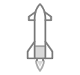 | Fuel drains while the nozzle flame flickers. |
| Epoch · past expected end |  | Empty tank with the flame off. |
| Off-time · learning |  | Pulsing fuel connection on the launch pad, without a predicted fuel level. |
| Off-time · countdown |   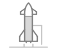 | Fuel fills on the launch pad. |
| Off-time · past expected start |  | Full tank on the launch pad. |

## Updating the stills

The images are rendered from the production QML, rather than drawn separately. After changing a graphic, run `python3 scripts/notification_assets.py` from the repository root. See [development checks](development-checks.md) for rendering and centering requirements.
