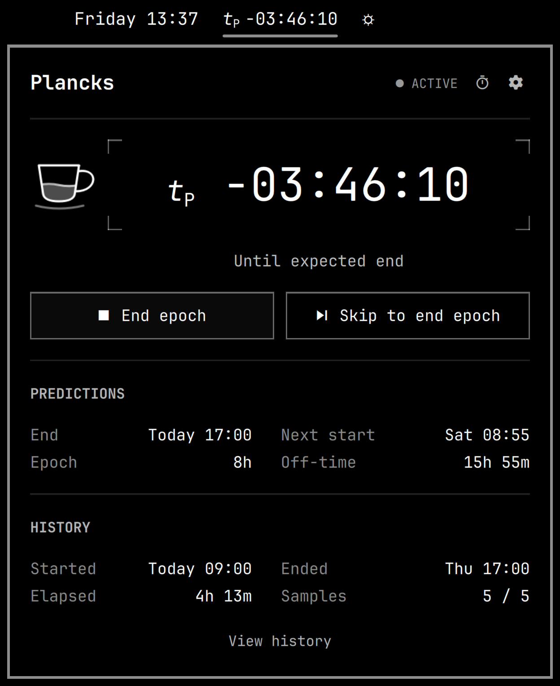
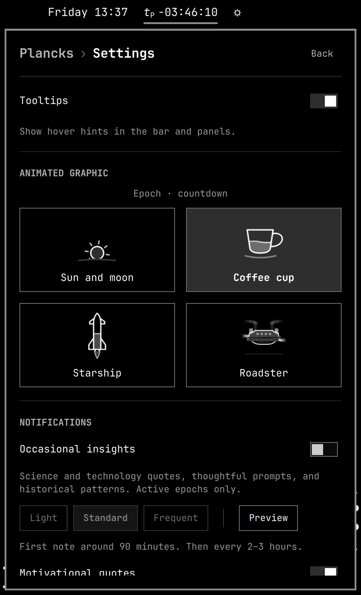
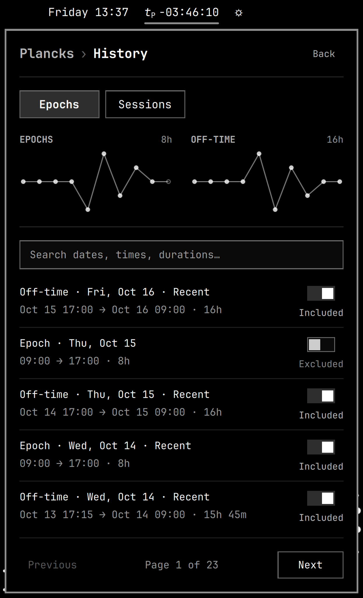
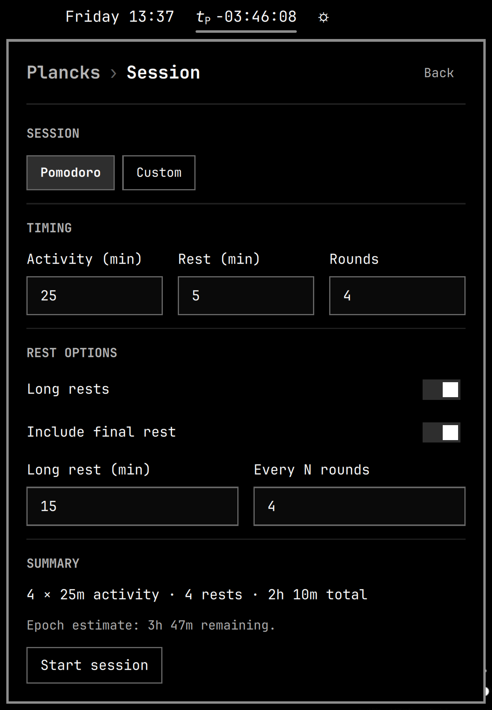
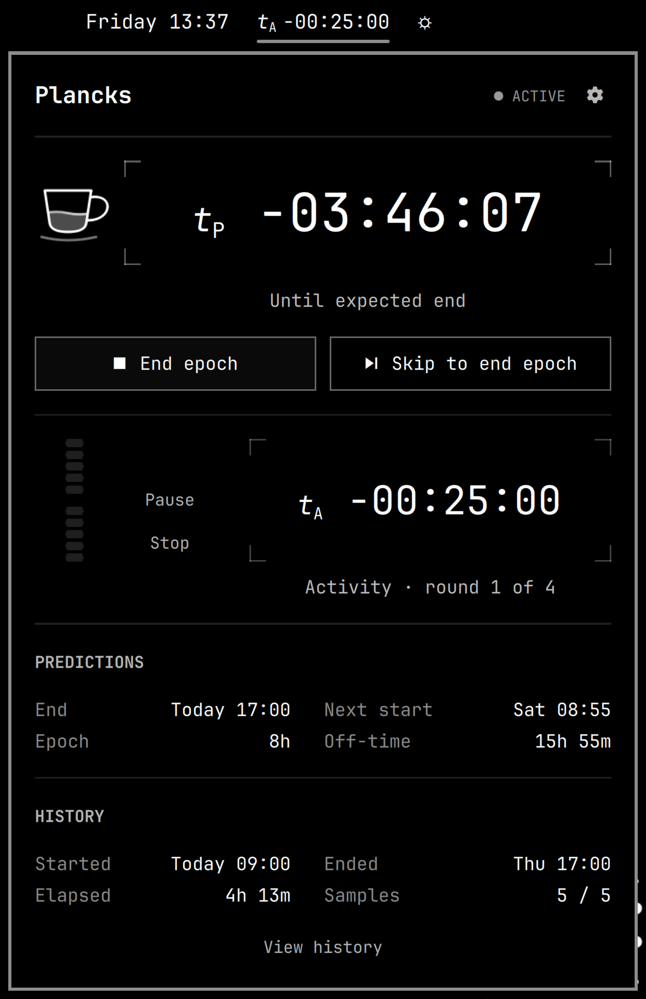
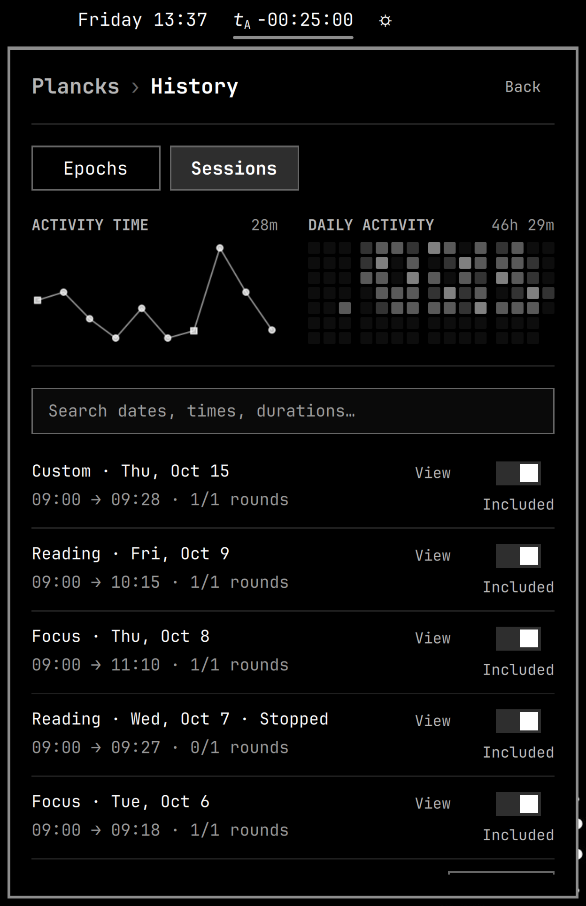

# Plancks user guide

An **epoch** is your window of available opportunity; **off-time** is the interval between epochs. Start an epoch when you get out of bed or sign in to work, and end it when you go to bed or sign out—usually once each per day.

Plancks learns from recent epochs and off-time intervals to predict when your current epoch will end and when the next one will start. The window includes normal breaks and interruptions; it measures available opportunity, not continuous productive effort.

The widget renders Planck-time notation as italic **t** with an upright subscript capital **P**, equivalent to `t_P`. Durations are ordinary hours, minutes, and seconds.

The bar and panel timer use normal text for an active epoch and Omarchy's standard dimmed styling for off-time. The tooltip, accessible label, and panel name the phase explicitly.

Choose **Sun and moon**, **Coffee cup**, **Starship**, or **Roadster** in Settings. The selected graphic sits to the left of the main panel’s timer. Sun and moon descend toward a horizon; Coffee cup, Starship, and Roadster empty during an epoch and refill during off-time. Roadster hovers on cold-gas streams and rolls once across 45%–55% of a predicted epoch, then parks for off-time. See the [animation reference](animations.md) for stills of every state and descriptions of their motion.

While learning, each graphic animates without showing predicted progress. Past the expected time, it holds its endpoint appearance while the positive timer shows how far past the prediction you are. Animations run while the timer panel or Settings previews are open.

| Appearance | Example | Meaning |
| --- | --- | --- |
| Normal | `t_P −02:00:00` | Two hours until the current epoch is expected to end |
| Normal | `t_P +00:15:00` | The current epoch is still active, fifteen minutes after its expected end time |
| Dimmed | `t_P −02:00:00` | Two hours until the next epoch is expected to start |
| Dimmed | `t_P +00:15:00` | The next epoch has not started, and its expected start time was fifteen minutes ago |

The timer descriptions use **Until expected epoch end** / **Since expected epoch end** while an epoch is active, and **Until expected next epoch start** / **Since expected next epoch start** during off-time.

Starting or ending an epoch changes its active/off-time appearance; passing an expected time does not. Resetting also returns the widget to off-time. Storage errors show an undimmed `!` marker. Click the widget to open its panel, then use **Start epoch** / **End epoch**. The panel groups forecasts under **Predictions** and actual timestamps, elapsed time, and sample counts under **History**. Open **Settings** using the gear in the main panel’s header. The **Animated graphic** section selects one graphic for the timer. Options appear two per row and preview ready, learning, countdown, and overrun states together in a sped-up loop, with one shared state caption above the tiles; the selected option is saved across restarts. The **Tooltips** switch controls hover hints in the bar and both panels; its preference is saved across restarts. Hover details for full timestamps and durations; the Samples tooltip explains the epoch/off-time counts and which intervals qualify for predictions. Select **View history** below the History details to browse completed epochs and off-time intervals, five per page. Compact epoch and off-time trends show the latest ten completed intervals of each kind, independently of pagination. Charts disappear when there is no valid data; hover points for details, and hollow points mark excluded intervals. The **Included** / **Excluded** switch controls whether each interval is eligible for learning; skipped intervals can be included again. Recent eligible samples are marked, while intervals invalidated by backwards clock changes remain excluded. Changes save immediately and recalculate the current prediction when its sample window changes, keeping the original start time. The **Plancks › History** header identifies the page; select **Plancks**, select **Back**, or press Escape to return to the main panel. Tab moves between buttons, and Enter or Space activates the focused button. With focus on the panel itself, Enter or Space starts or ends an epoch (or retries a storage error). Escape closes the panel, or cancels an open reset confirmation.

<p align="center">
  
  <br>
  <em>Your day at a glance: time remaining, predictions, and recent history. Sample data shown.</em>
</p>

## Notifications

Configure optional insights and finish alerts in Settings. See [Notifications](notifications.md) for all variations, message examples, scheduling, session target alerts, and image formats.

<p align="center">
  
  <br>
  <em>Make it feel like yours with Sun and moon, Coffee cup, Starship, or Roadster and optional insights.</em>
</p>

## Install

Requires an Omarchy release with the Quickshell plugin system and shared `qs.Ui` components, plus Python 3.9 or later. The timer uses Python's standard library; desktop notifications also use Python GObject, included in standard Omarchy installations. It does not support the older Waybar shell.

Pasting requires `wl-paste` from `wl-clipboard` (included with Omarchy).

Install through Omarchy:

```bash
omarchy plugin add https://github.com/gregl83/omarchy-plancks.git --enable
omarchy bar move gregl83.plancks --after omarchy.clock
```

Omarchy creates the plugin directory, clones the repository, validates it, and enables the widget. Plancks creates its runtime storage automatically. There are no directories to create manually. The manifest defaults to the center section; the second command places the widget immediately after the clock.

### Update

For a Git-based installation:

```bash
omarchy plugin update gregl83.plancks
omarchy restart shell
```

Restarting the shell loads the updated shared controller and Python helper. Your saved history survives the restart. Copy-only development installations use the [development installation copy procedure](development-installation.md#test-uncommitted-development-changes) instead.

## Learning your daily rhythm

With no history and the default settings, the first epoch counts up from `+00:00:00`. The first off-time interval does the same, starting when you end that epoch. Without a prediction, `+` means elapsed time in the current phase; the tooltip and panel show “Epoch elapsed · learning your rhythm” or “Off-time elapsed · learning your rhythm.” Once a prediction exists, `+` means time since the expected epoch end or next epoch start. Before the first epoch starts, or immediately after a reset, the timer shows `--:--:--` because no interval has started yet.

For each prediction, Plancks uses up to five recent completed intervals of that kind. With five samples, it drops one shortest and one longest and averages the remaining three. Epoch and off-time histories are independent. With one or two samples, it uses their mean; with three or four, it drops the extremes and averages what remains. Predictions round to whole seconds with a one-second minimum.

A daily window of 07:00–23:00 teaches a 16-hour epoch duration. Starting again at 07:00 teaches eight hours of off-time. A workday sign-in/sign-out routine learns its own durations with the same model.

While active, the next-start forecast uses the expected end plus expected off-time. Ending the epoch anchors that forecast to the actual end. The current phase's expected duration stays fixed until you start or end an epoch, including after shell reloads. Late starts and overruns do not change phase automatically.

Settings live inline on the widget's entry in Omarchy's `shell.json`. To supply an initial eight-hour epoch estimate before any history exists:

```bash
omarchy bar set gregl83.plancks initialSeconds 28800 --json
```

The default `initialSeconds` is `0` (learn first); an initial estimate must be at least one second. Changing it affects future starts without history; it does not change an active epoch. The optional `rotateBytes` setting defaults to `5242880` (5 MiB).

### Skip unusual periods

The skip button changes phase while excluding the period you are leaving from prediction learning. Its timestamps and duration stay recorded.

| Action | Period excluded |
| --- | --- |
| **Skip to start epoch** | Off-time since the last epoch ended |
| **Skip to end epoch** | The current epoch |

Use **Skip to start epoch** after a weekend, or **Skip to end epoch** when you forgot to stop. If you immediately start again, use both skip actions to exclude the brief gap too. Normal actions resume learning.

Skipped intervals stay in history and can be included again through **View history**.

### History and trends

History shows five intervals per page, with inclusion switches and separate epoch and off-time duration trends. Each chart shows up to ten completed intervals, stays fixed while paging, and disappears without valid data. Changing an interval's inclusion updates relevant predictions while keeping the current interval's original start time.

The search box matches across all completed history before pagination. Search either endpoint's local date or time (`Oct 6`, `October 6`, `2026-10-06`, `09:30`), a duration (`8h 30m`, `8h30m`, `08:30:00`), or labels such as `epoch`, `off-time`, `included`, `excluded`, and `recent`. Matching ignores case, and combined terms narrow the results—for example, `Oct 6 epoch excluded`. Bare numbers make broad matches across dates, times, and durations. Results update as you type; **Clear** restores the full list. With the search field focused, Escape clears a nonempty search and keeps focus in the field; Escape when empty returns to the main panel. Trend graphs continue to show the latest intervals across all history.

<p align="center">
  
  <br>
  <em>Spot patterns in your days and choose which intervals shape your predictions.</em>
</p>

## Sessions

Within an active epoch, select the **Configure session** timer icon immediately left of Settings in the panel header. Pomodoro supplies 25-minute activity, 5-minute short rests, 15-minute long rests every four rounds, four rounds, and **Include final rest** enabled. Custom configurations support 1–180 whole minutes and 1–12 rounds/cadence. One round with no final rest is a standalone activity timer. The summary reflects the actual rest sequence; the final rest uses the same short/long cadence as other rests.

<p align="center">
  
  <br>
  <em>Set up a Pomodoro or choose a rhythm of your own.</em>
</p>

Custom sessions support an optional **Session name** (up to 80 characters). The name is saved with the last-used configuration and each run, appears in the panel and history, and is searchable. Existing unnamed configurations remain supported.

Session history uses the same date, weekday, time, and duration search formats as epoch history, including `Tue`, `Tuesday`, `10/6/2026`, `09:30:00`, `8h30m`, and `08:30:00`. Session names, presets, inclusion state, outcomes, and activity/rest labels are also searchable. Durations match the session's elapsed time, totals, and planned or recorded stage durations. Both histories use **Clear**, live result counts, Enter to search immediately, and Escape to clear before leaving. Reopening preserves the query; switching history tabs clears the destination search. Trends remain independent of filtering.

Configuration is unavailable during off-time. Opening or cancelling a draft creates no timer events. A successful start remembers its configuration; editing future defaults does not change the running session. An epoch forecast is informational and never prevents starting a longer session. Configuration summaries use compact hours and minutes consistently (for example, `3h 23m` remaining or `15m` beyond the epoch estimate).

Session timers count down with `−HH:MM:SS`, show `+00:00:00` at the target, and count up with `+HH:MM:SS` after the target. Each stage has a [target notification](notifications.md#variations-and-examples). Select **Start rest**, **Start activity**, or **Finish session** yourself; no stage advances automatically. Early advancement is disabled. **Stop** ends the whole session and preserves partial progress. **Pause/Resume** freezes the signed timer and records paused time separately while the epoch continues.

The bar switches to **t_A** for activity or **t_R** for rest, with a pause marker where applicable. The panel keeps the epoch timer and graphic above the session timer; all four graphics retain their epoch meaning. Closing the panel, sleeping, rebooting, or working away from the computer does not stop an unpaused session. After recovery, the same stage includes any overrun, with [notification recovery](notifications.md#settings-and-scheduling) handled separately. Already-paused sessions remain paused.

<p align="center">
  
  <br>
  <em>Keep your activity or rest timer alongside the bigger picture of your day.</em>
</p>

Session tooltips follow the epoch pattern: full timestamps on hover, explanations beside detail values, and concise action consequences on controls. The session progress bar has ten subtly beveled blocks, each representing 10%, with a larger gap at 50%. Its tooltip shows current-stage percentage and segment meaning. The shared **Tooltips** switch controls these hints; accessible action descriptions remain available when hints are disabled.

Session details show four stages per page in chronological order. **Previous · Page X of Y · Next** changes only the stage list and returns focus to its heading; settings and totals stay above it. Pagination is hidden for four or fewer stages, and opening a session starts at its first stage page.

Ending or skip-ending an epoch with an unfinished session opens **End session and epoch** confirmation, including from the explicit epoch or skip shortcut when the panel is closed. Cancel/Escape leaves the timers alone; repeated shortcuts cannot confirm it. Confirmation records a stopped session and closes the epoch atomically, retaining the normal/skip learning choice. Without an unfinished session, epoch actions remain immediate. The primary shortcut advances sessions instead; see below.

History offers **Epochs | Sessions**. Session rows show preset, outcome, and completed/planned rounds, with **Details** and an **Included/Excluded** switch matching epoch history. Excluding a session removes it from session totals and personal bests without deleting or changing its recorded times. The change is reversible and independent of the parent epoch's prediction setting. Activity-time graphs retain excluded sessions as hollow points; stopped sessions use square points. Beside the activity-time graph, a contribution-style grid shows as many weeks of daily activity as fit the panel (up to 26), with four-week groups separated by small gaps; the oldest group may be partial so the grid fills the column. Each column is a week, Monday through Sunday from top to bottom. Three subtle shades show activity under 30 minutes, 30–89 minutes, and 90 minutes or more; empty days stay faint. The header shows total included activity across the displayed weeks (for example, `3h 2m`). Hover for the date, activity time, and session count. The grid includes completed and stopped sessions, counts activity without pauses or rests, and groups it by the session’s local finish date. Excluded and clock-invalid sessions do not contribute. Both charts stay independent of search and pagination. Search also accepts `included` and `excluded`.

<p align="center">
  
  <br>
  <em>Look back at your sessions and the progress you made.</em>
</p>

Session detail shows completed/partial activity, the parent epoch, frozen configuration, and planned/actual durations, differences, overruns, and paused time per stage. Session durations never enter epoch prediction samples. Clock-invalid sessions cannot be manually included. Occasional motivational insights are suppressed during activity (including pause and overrun); configured epoch-finish warnings remain eligible.

The helper also supports `session-start`, `session-pause`, `session-resume`, `session-advance`, `session-finish`, and `session-stop`, with `--sequence` from `status`. `session-start --session-config FILE` reads a complete JSON configuration; omitting it uses Pomodoro. Raw epoch `end` rejects an unfinished session unless `--cascade-session SESSION_ID` explicitly identifies it. All commands use the same journal and storage lock.

## Optional keyboard shortcut

While the widget is loaded, **Primary action** follows the current timer:

| State | Primary action |
|---|---|
| No session | Start epoch / End epoch |
| Activity or rest before target | Open session controls |
| Paused session (including overrun) | Open session controls |
| Stage at or beyond target | Start rest / Start activity |
| Final stage at or beyond target | Finish session |

```bash
omarchy-shell gregl83.plancks primaryAction
```

The bar tooltip shows the current **Primary action**, or **Review epoch confirmation** while confirmation is pending. Opening session controls never advances, pauses, or resumes a stage. An invalid clock also opens controls. Finishing a session leaves its epoch running. An open epoch-end confirmation stays pending until explicitly confirmed or canceled.

**Skip epoch** remains `omarchy-shell gregl83.plancks toggleEpochSkip`: skip to start/end the epoch and exclude the completed interval from predictions. With an unfinished session, it opens **End session and epoch** confirmation. The explicit `toggleEpoch` command still starts/ends epochs with the same confirmation; panel epoch buttons and their Enter/Space action retain that behavior.

IPC results: `submitted` means sent to storage (not yet saved); `controls-opened` means session controls opened; `confirmation-pending` means explicit confirmation is required; `repeat-ignored` means a rapid repeat was suppressed; `busy` and `not-ready` mean no action was taken. Storage failures appear in the widget and panel with **Retry**.

To assign **Super+Alt+P**, first check conflicts with `omarchy menu keybindings --print`, then add these optional bindings to `~/.config/hypr/bindings.lua`:

```lua
o.bind("SUPER + ALT + P", "Plancks: Epoch / next stage", "omarchy-shell gregl83.plancks primaryAction")
o.bind("SUPER + ALT + SHIFT + P", "Plancks: Skip epoch", "omarchy-shell gregl83.plancks toggleEpochSkip")
```

Existing primary bindings must change from `toggleEpoch` to `primaryAction` to get situational behavior. Keep key repeat disabled (the default): holding either shortcut must not repeat transitions. Primary action also suppresses repeated calls until 600 ms pass without another invocation, preventing a burst from finishing a session and then ending its epoch.

Choose an unused combination, or explicitly unbind an existing assignment before replacing it. Validate with `hyprctl reload` and `hyprctl configerrors`. The plugin installer does not install keybindings automatically. After updating the controller in an existing installation, run `omarchy restart shell` to register the new IPC action.

## Reset all data

Open the widget panel, select **Settings**, then **Reset all data…** in the **Data** section. A warning explains what will be deleted; **Cancel** is focused by default. Select **Delete all data** to permanently delete recorded epochs, off-time intervals, and learned predictions and discard any active epoch. Escape cancels the confirmation. Reset cannot be undone; back up the [storage directory](#persistence-and-recovery) first if you want to keep your history.

The widget returns to its initial off-time state and learns again from new epochs. Widget settings (`initialSeconds`, `rotateBytes`, and bar placement) stay intact. Reset is also available when damaged history prevents starting or ending an epoch. Other instances of the widget refresh automatically. Reset requires writable storage and valid reset metadata; it cannot repair filesystem permissions or a damaged `events/.reset.json` file.

## Remove

To delete your recorded epochs and learned predictions, use [Reset all data](#reset-all-data) **before uninstalling**. Otherwise, saved history remains in the [storage directory](#persistence-and-recovery) for a future reinstall.

Remove the plugin with:

```bash
omarchy plugin remove gregl83.plancks
```

If you added the optional keyboard shortcut, remove the Plancks `o.bind(...)` entries containing `omarchy-shell gregl83.plancks` from `~/.config/hypr/bindings.lua`. Then reload and check the configuration:

```bash
hyprctl reload
hyprctl configerrors
```

## Persistence and recovery

Moving computers? Follow the [migration guide](migration.md) to transfer your history and timers.

Plancks stores data locally and makes no network requests. It starts one Python helper shared by the widget instances; it requires no account or elevated permissions.

Runtime history lives at `$XDG_STATE_HOME/omarchy/gregl83.plancks/`, falling back to `~/.local/state/omarchy/gregl83.plancks/`. A relative XDG path is ignored.

- `events/events-00000001.jsonl`, etc.: append-only epoch, session, and history inclusion-change records, rotated before the next record exceeds the segment limit. All segments are retained until you reset the data. One record may exceed a very small configured limit.
- `state.json`: the single mutable snapshot, replaced atomically after a durable journal append. Includes phase, clock anchors, the current prediction, recent samples, epoch/session history, and replay position. Snapshot schema 2 is rebuilt from the journal.
- `events/.reset.json`: a reset token and completion flag, containing no epoch history. It prevents stale commands and duplicate reset retries from deleting new history and allows interrupted deletion to finish on recovery.
- `insights.json` and `insights.lock`: optional notification deadlines, delivery IDs, recent wording/facts, and coordination. Created when notifications are enabled during an active epoch and cleared by Reset all data.
- `.lock`: an empty coordination file for serializing helper instances; it contains no epoch state.

The journal is authoritative. Plancks replays and validates it on startup or when its files change, then caches the result in memory. A missing or damaged snapshot is rebuilt. An incomplete final record is preserved and the next append goes into a new segment. Malformed complete records or missing segments block updates and display an error. Back up the entire directory together; ordinary journal recovery never deletes history. Once a reset is confirmed, recovery finishes any interrupted deletion.

Session events and compound epoch/session closure use journal schema 2; legacy epoch schema 1 remains readable without rewriting it. Older Plancks releases reject schema-2 records: after starting sessions, do not downgrade against this history. Back up the entire state directory before upgrading or restoring a previous version. See [notification delivery and recovery](notifications.md#delivery-and-recovery) for target milestone claims.

Ordinary one-second updates use cached state and predictions: they do not scan, read, lock, or write history files. An in-process Linux inotify watch detects journal changes without another watcher process. The helper sends only changed timer/status fields; elapsed details update while a panel is open. Before there is any running display to update, it sleeps until a command or file change. Multiple monitor widgets share a controller, and storage also locks and checks revisions to reject stale commands. If storage fails, the panel reports the failure and offers **Retry**; retries reuse the request ID to avoid recording an action twice.

Elapsed time includes suspend and uses Linux's suspend-inclusive monotonic clock within a boot. Across reboots it falls back to UTC timestamps; a backwards interval is flagged and excluded from learning. An active epoch stays active through suspend, shutdown, and midnight until you end it or reset the data. Long absences, including weekends, are included in off-time samples unless you use **Skip to start epoch**. Plancks has no automatic schedule or timestamp correction. History inclusion changes are appended to the journal without rewriting original intervals.
